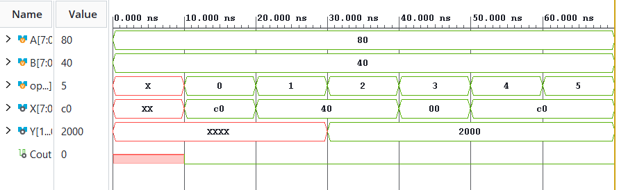

# 8-Bit Arithmetic Logic Unit (ALU) Using Verilog HDL

## 📌 Project Overview

This project implements an **8-bit Arithmetic Logic Unit (ALU)** using Verilog HDL. An ALU is a fundamental digital circuit in processors that performs arithmetic and logical operations on binary data.

The design supports six operations: addition, subtraction, multiplication, bitwise AND, bitwise OR, and bitwise XOR. The functionality is verified using a Verilog testbench and simulation waveforms.

## ✨ Features

- 8-bit input operands `A` and `B`
- Six arithmetic and logical operations
- 8-bit result output `X`
- 16-bit multiplication output `Y`
- Carry-out output `Cout` for addition
- Combinational logic design
- Automated simulation using a Verilog testbench
- Waveform-based functional verification

## ⚙️ Operation Table

| Opcode | Operation | Description |
|---|---|---|
| `000` | Addition | Adds A and B |
| `001` | Subtraction | Subtracts B from A |
| `010` | Multiplication | Multiplies A and B |
| `011` | AND | Performs bitwise AND |
| `100` | OR | Performs bitwise OR |
| `101` | XOR | Performs bitwise XOR |

## 🧪 Simulation Results

The testbench uses the following input values:

- `A = 8'h80` (128 decimal)
- `B = 8'h40` (64 decimal)

Expected results:

| Operation | Expected Result |
|---|---|
| Addition | `X = 8'hC0`, `Cout = 0` |
| Subtraction | `X = 8'h40` |
| Multiplication | `Y = 16'h2000` |
| AND | `X = 8'h00` |
| OR | `X = 8'hC0` |
| XOR | `X = 8'hC0` |

### Simulation Waveform



The waveform demonstrates how the ALU responds to different opcode values while the input operands remain constant.

## 🛠️ Tools and Technologies

- **Language:** Verilog HDL
- **Simulation:** Xilinx Vivado Simulator (XSim), or another compatible Verilog simulator
- **Design Type:** Combinational Digital Logic
- **Verification:** Verilog Testbench and Waveform Analysis

## 📂 Project Structure

```text
Verilog-8-bit-ALU/
├── alu.v
├── alu_tb.v
├── waveform.png
└── README.md
```

## ▶️ How to Run

1. Open your Verilog design project in Vivado.
2. Add `alu.v` as the design source.
3. Add `alu_tb.v` as the simulation source.
4. Set `alu_tb` as the simulation top module.
5. Run behavioral simulation.
6. Open the waveform window and inspect `A`, `B`, `op`, `X`, `Y`, and `Cout`.
7. Compare the simulated outputs with the expected results.

## 📚 Learning Outcomes

- Understanding combinational circuit design using Verilog.
- Implementing arithmetic and bitwise operations in hardware description languages.
- Learning opcode-based operation selection using `case`.
- Writing testbenches for functional verification.
- Interpreting simulation waveforms and validating expected outputs.

## 🔮 Future Enhancements

- Add shift-left and shift-right operations.
- Implement subtraction borrow detection.
- Add zero and overflow flags.
- Extend the design to a 16-bit or 32-bit ALU.
- Develop a self-checking testbench with automatic pass/fail reporting.

## 👨‍💻 Project Details

**Project:** 8-Bit Arithmetic Logic Unit  
**Domain:** Digital Design and Embedded Hardware  
**HDL:** Verilog  
**Design Category:** Combinational Logic


